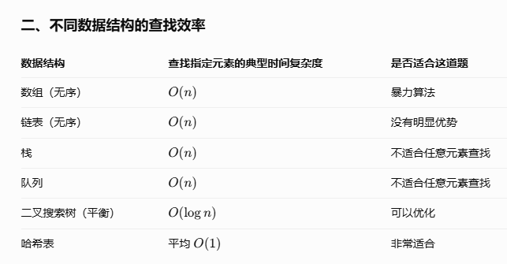

# 两数之和

这实际上是给定一个数从一堆数字中找到和为这个数的值

## 方法一：定a移b重复到末尾

时间复杂度：O（n2）

这是比较简单的

## 方法二：寻找一种时间复杂度小于n2的算法

整体上我可能会从数据结构的角度去寻找算法，常见的数据结构通常包括：链表（本质上找a、b是存在先后顺序的，及a肯定是先于b找到的），这样的话可以定a，然后找b的时候每次判断a+b>=tager这轮就可以结束、<target的时候b继续+1。这种情况好像会更优一些，但好像复杂度还是n2-------错误，这种不对，因为数组并不是升序不能这种先后顺序

队列、栈、set、堆（？属于数据结构吗）、树、图

找到第一个数字后第二个数字其实是确定的，也就是需要找在数组中这个数的index，-》搜索算法了

为什么hash的查找效率是1啊

此外需要区分hash表和直接寻址表

1. 直接寻址表（Direct Address Table）：直接用数据值作为数组下标。
2. 哈希表（Hash Table）：先通过哈希函数将数据值转换为数组下标。

对于数值范围过大的情况则不能使用直接寻址表，而是需要使用哈希表将范围进行缩减-》这里就会导致另外一个问题，哈希冲突，及重复位置占用的问题

这里有多种解决方法，最简单的是线性插入=》被占用及+1，使用hash需要insert和find以及hash计算函数

注意：`2654435761u` 是一个经典的乘法哈希常数（Multiplicative Hashing Constant），它的作用是尝试将整数 Key 映射得更加分散，从而减少哈希冲突。
